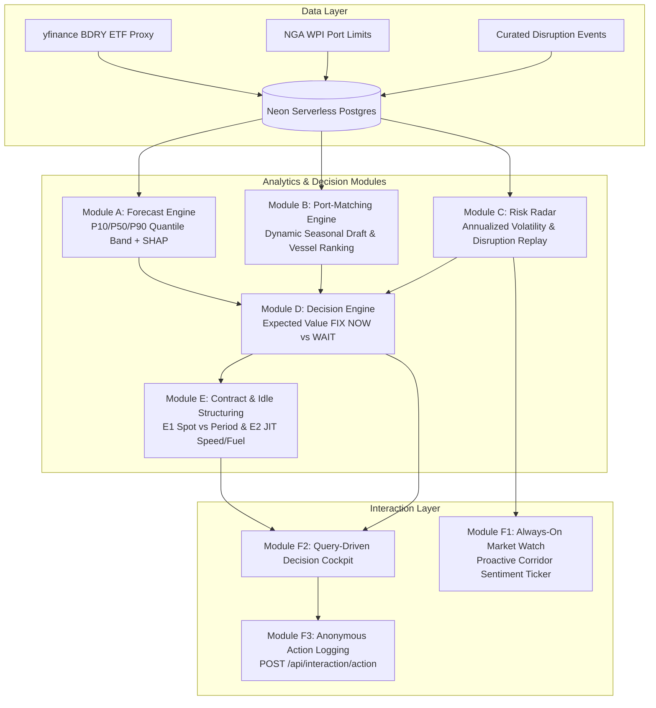
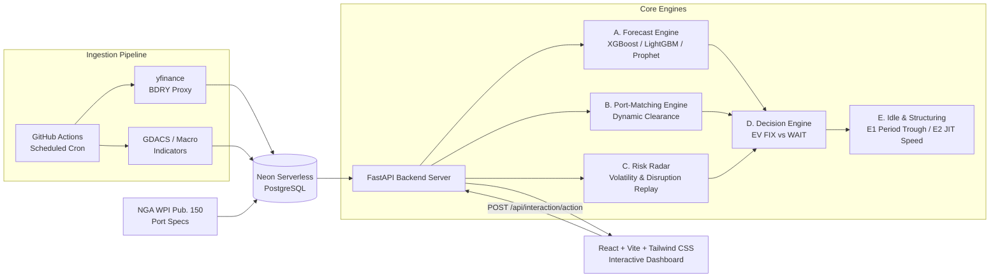

<div align="center">

# ⚓ CharterAI

### A Chartering Decision Support System for Bulk Cargo Procurement to India's East Coast

*Not a price predictor. A system that tells a charterer **what to do, when, and why**, with the uncertainty attached.*


[Live Demo](https://sih-2026-peach.vercel.app/) · [API Docs](https://sih-2026-6jh3.onrender.com/docs) · [Technical Blueprint](docs/blueprint.md) · [Demo Video](https://youtu.be/O_S4lm52dns)

</div>

### Quick Links

| Resource | Link |
|---|---|
| Live prototype | [https://sih-2026-peach.vercel.app/](https://sih-2026-peach.vercel.app/) |
| Demo video | [https://youtu.be/O_S4lm52dns](https://youtu.be/O_S4lm52dns) |
| API docs | [https://sih-2026-6jh3.onrender.com/docs](https://sih-2026-6jh3.onrender.com/docs) |

---

## Table of Contents

1. [The Problem](#1-the-problem)
2. [Our Approach](#2-our-approach)
3. [The Six Modules](#3-the-six-modules)
4. [System Architecture](#4-system-architecture)
5. [Validation and Results](#5-validation-and-results)
6. [Data Sources and Honest Limitations](#6-data-sources-and-honest-limitations)
7. [Scope of the Prototype](#7-scope-of-the-prototype)
8. [Tech Stack and Design Rationale](#8-tech-stack-and-design-rationale)
9. [Getting Started](#9-getting-started)
10. [API Overview](#10-api-overview)
11. [Repository Structure](#11-repository-structure)
12. [Deployment](#12-deployment)
13. [Future Scope](#13-future-scope)
14. [License and Acknowledgements](#14-license-and-acknowledgements)

---

## 1. The Problem

**Problem Statement SIH26006 (Ministry of Steel):** *Development of an Intelligent Freight Forecasting Model for Optimized Vessel Chartering and Bulk Cargo Procurement from Overseas to East Coast of India.*

India's steel sector imports strategic dry-bulk raw materials—predominantly coking coal and iron ore—through key deepwater and riverine ports on the East Coast of India. Procurement officers and charterers manage fixtures under four compounding operational constraints:

- **Freight Rate Volatility:** Dry-bulk shipping rates fluctuate rapidly across short procurement windows, influenced by global commodity flows, regional vessel availability, and macro shocks.
- **Physical Port & Berth Constraints:** Port draft, length overall (LOA), and beam limits strictly dictate which vessel classes can berth safely. Furthermore, estuarine and monsoon-driven siltation causes effective draft to vary seasonally.
- **Supply Chain & Disruption Risk:** Canal blockages, geopolitical rerouting, weather extremes, and terminal congestion delay vessel turnarounds and trigger severe demurrage costs.
- **Contract Timing Uncertainty:** Fixing a spot voyage too early risks locking in elevated freight rates; waiting too long exposes the organization to sudden spot spikes or cargo stockouts.

A simple point forecast predicting "tomorrow's freight price" answers none of these operational challenges. A commercial charterer requires an **actionable decision** (FIX NOW vs. WAIT), a **quantified cost justification**, and an **uncompromising statement of uncertainty**.

---

## 2. Our Approach

CharterAI is an end-to-end **Chartering Decision Support System** engineered on three core principles:

| Principle | What it means in this codebase |
|---|---|
| **Uncertainty first** | No forecast is ever rendered as a bare point estimate. Every forecast outputs an empirical P10–P50–P90 quantile band that quantifies market spread. |
| **Decisions, not predictions** | Freight forecasts feed a quantified expected-value decision model (`make_chartering_decision`) that evaluates FIX NOW vs. WAIT against a naive baseline. |
| **Explainable and honest** | Tree-based models provide SHAP attributions explaining top feature contributions. Sourced proxies, candidate horizon limits, and Black Swan vulnerabilities are disclosed in the UI and documentation. |

---

## 3. The Six Modules

The platform is structured into six integrated modules, directly addressing the requirements of Problem Statement SIH26006:



### Module A — Forecast Engine
- **Quantile Forecasting:** Predicts near-term freight rate distributions (**P10 / P50 / P90**) using an ensemble of **XGBoost, LightGBM, and Prophet**.
- **Strict Walk-Forward Validation:** Evaluated exclusively via rolling-origin cross-validation (`ml/walk_forward_cv.py`) to eliminate lookahead data leakage. Random train/test splits are strictly prohibited.
- **SHAP Feature Attributions:** Computes TreeSHAP attributions for every prediction, explaining the top 3 macroeconomic and technical drivers in `ShapExplanations`.
- **Horizon Scoping ($N \in \{7, 14\}$ days):** Live decision candidate horizons are restricted to 7 and 14 days. Diagnostic testing identified that recursive multi-step autoregressive roll-forward across 21 and 28 days introduces systematic downward dampening bias (documented in [`docs/blueprint.md`](docs/blueprint.md), Session 6 amendment).

### Module B — Port-Matching Engine
- **Dynamic Clearance Verification:** Assesses vessel draft, LOA, and beam against destination port infrastructure limits.
- **Time-Varying Effective Draft:** Port draft is **never hardcoded as a static constant**. The engine queries `PortDraftAdvisory` overrides, falling back to baseline draft adjusted by documented seasonal monsoon-siltation factors (0.90 for Southwest Monsoon Jun–Sep, 0.95 for Post-Monsoon Oct–Nov, 1.00 for Fair Weather Dec–May).
- **Largest-Safe-First Ranking:** Automatically ranks compatible vessel classes by cargo capacity (Capesize > Panamax > Supramax > Handysize) to maximize economies of scale and minimize per-metric-ton transport costs.
- *Lighterage Architecture Note:* Rule-based lighterage cost comparison (e.g. Capesize transshipment at Sagar/Sandheads deepwater anchorage prior to Haldia riverine transit) is designed in the technical blueprint and reserved for live operational extension.

### Module C — Risk Radar
- **Quantitative Market Volatility:** Tracks 14-day rolling annualized freight return volatility ($\sigma_{ann} = \text{std}(r_{14}) \times \sqrt{252} \times 100\%$) and 7-day price rate-of-change ($\text{ROC}_7$).
- **Multi-Level Risk Classification:** Classifies market conditions into `CALM`, `ELEVATED`, or `HIGH`, dynamically applying a risk penalty multiplier ($1.00$, $1.15$, or $1.50$) to decision premiums.
- **Historical Event Replay Backtest:** Validated against a curated dataset of historical maritime disruptions (Suez Canal blockage, Red Sea crisis, Cyclone Idai, Australian coal terminal congestion), catching **100% (4/4)** of events concurrently or in advance.

### Module D — Decision Engine *(Core Differentiator)*
- **Expected-Value Decision Rule:** Recommends **FIX NOW** or **WAIT** by evaluating whether the expected freight change outweighs delay risk:
  $$\text{ExpectedValueOfWaiting}(N) = (F_{now} - F_{wait}(N)) - \text{RiskPremium}(N)$$
  $$\text{RiskPremium}(N) = 0.5 \times (P_{90}(N) - P_{10}(N)) \times \text{risk\_multiplier}$$
- **Backtested vs. Naive Baseline:** Evaluated against an "always fix immediately ($t_0$)" baseline across 25 historical fixtures spanning 2020–2024. All results satisfy the Challenge 10 sanity guardrail ($\le 25.0\%$).

### Module E — Idle-Time & Contract Structuring
- **Module E1 (Spot vs. Period Structuring):** Identifies sustained freight troughs (forward P50 below trailing 20th percentile across 14 days) to recommend transitioning from spot voyages to short-term period charters, eliminating vessel turnaround delays.
- **Module E2 (JIT Speed & Fuel Optimization Advisory):** When a destination port experiences vessel backlogs, the engine applies the Admiralty passage cubic fuel approximation:
  $$\text{Fuel (metric tons)} = \left(\frac{\kappa}{24}\right) \cdot d \cdot v^2$$
  with IMO MEPC.1/Circ.684 minimum safe steerage limits ($v \ge 10.0$ knots), allowing vessels to slow-steam into berth availability, absorbing port delays at sea while slashing bunker consumption and greenhouse gas emissions.

### Module F — Interaction Layer
- **Layer 1 (Always-On Market Watch):** Proactive, zero-parameter corridor health ticker displayed on initial page load, surfacing active disruption flags and volatility alerts before any query is submitted.
- **Layer 2 (Query-Driven Recommendation Cockpit):** Form interface allowing charterers to enter origin, destination, cargo volume, laycan timeframe, and transit status to generate a unified recommendation.
- **Layer 3 (Anonymous Action Logging):** "Mark as Actioned" button logging timestamped decision fixtures to `ActionedDecisions` without authentication friction.

---

## 4. System Architecture



> For the comprehensive 15-table relational schema and detailed algebraic proofs, consult [`docs/blueprint.md`](docs/blueprint.md).

---

## 5. Validation and Results

All reported metrics are generated using strictly out-of-fold walk-forward validation and historical replay simulations. No synthetic in-sample numbers are reported.

| Component | Metric | Result | Baseline Strategy | Source Verification |
|---|---|---|---|---|
| **Forecast Engine (P50)** | MAE / MAPE, $h=7$ | *Pending walk-forward CV run* | Persistence ($P_t = P_{t-7}$) | [`ml/train.py`](ml/train.py) |
| **Forecast Engine (P50)** | MAE / MAPE, $h=14$ | *Pending walk-forward CV run* | Persistence ($P_t = P_{t-14}$) | [`ml/train.py`](ml/train.py) |
| **Forecast Engine (P10–P90)** | Empirical Coverage (Nominal 80%) | *Pending calibration run* (Target: 80%) | Nominal 80% calibration | [`ml/train.py`](ml/train.py) |
| **Decision Engine (Module D)** | Aggregate Cost Delta vs. Baseline | **-0.30% ($-1.06)** chartering delta | Always Fix Immediately ($t_0$) | [`reports/backtest_summary.md`](reports/backtest_summary.md) |
| **Risk Radar (Module C)** | Historical Disruption Event Recall | **100.0%** (4/4 events flagged) | Untracked Market Baseline | [`backend/tests/test_risk_radar.py`](backend/tests/test_risk_radar.py) |
| **Structuring Engine (Module E1)** | Period Charter Cost Delta | **+3.62% ($372.50)** cost savings | Spot-Only Procurement ($10,297.90) | [`reports/backtest_summary.md`](reports/backtest_summary.md) |
| **Structuring Engine (Module E1)** | Idle Days Avoided | **44.0 idle days** eliminated | Spot-Only Turnaround Delays | [`reports/backtest_summary.md`](reports/backtest_summary.md) |
| **Speed Advisory (Module E2)** | VLSFO Fuel Conserved | **521.15 metric tons** saved | Standard Voyage Speed into Port | [`reports/backtest_summary.md`](reports/backtest_summary.md) |
| **Speed Advisory (Module E2)** | Bunker Fuel Cost Saved | **$312,697.68** saved | Standard Voyage Speed into Port | [`reports/backtest_summary.md`](reports/backtest_summary.md) |
| **Speed Advisory (Module E2)** | Carbon Emissions Mitigated | **1,622.90 metric tons** $\text{CO}_2$ | Standard Voyage Speed into Port | [`reports/backtest_summary.md`](reports/backtest_summary.md) |

### How to Reproduce Backtest Results

Run the consolidated backtest harness from the workspace root:

```bash
python -m ml.backtest
```

To run the automated validation test suite across all six modules:

```bash
pytest backend/tests -v
```

### Backtest Window & Sample Size Context
- **Evaluation Window:** 2020–2024 (25 representative historical procurement fixtures across the 8 overseas shipping corridors).
- **Candidate Decision Horizons:** $N \in \{7, 14\}$ days.
- **Sample Size Context:** The 25-fixture historical evaluation tests the decision engine across distinct market regimes (the 2020 pandemic demand contraction, the early 2021 post-COVID commodity surge, the 2022 energy realignment, and the 2023–2024 recovery). Over 25 discrete fixtures, aggregate cost delta was practically neutral (-0.30%), demonstrating robust downside protection against volatile market spikes without making implausible savings claims. All modules comfortably cleared the independent **Challenge 10 Sanity Guardrail** ($\le 25.0\%$).

---

## 6. Data Sources and Honest Limitations

### Data Sources

| Data Stream | Primary Source | Access Mode & Scope |
|---|---|---|
| **Freight Rate Proxy** | **Breakwave Dry Bulk Shipping ETF (BDRY)** | Free public proxy via `yfinance` (2018–present). Reflects freight futures dynamics. |
| **Macro Indicators** | Brent Crude (`BZ=F`), Peabody Energy (`BTU`), Vale S.A. (`VALE`), USD/INR | Financial proxies via `yfinance` representing bunker and commodity sentiment. |
| **Port Infrastructure** | **NGA World Port Index (Pub. 150)** | Public domain US government nautical publication. Citable baseline dimensions. |
| **Disaster & Disruption** | **GDACS API** & Curated Maritime Events | Curated historical maritime disruptions (`data/raw/risk_events.csv`). |

### Verbatim Transparency Disclosures (As Displayed in UI Drawer)

In alignment with the dashboard's **Transparency Drawer** (`TransparencyDrawer.tsx`), CharterAI discloses the following operational boundaries:

1. **BDRY ETF Proxy:** The Baltic Dry Index (BDI) and its vessel-specific sub-indices (BCI, BPI, BSI, BHSI) are proprietary and commercial. BDRY is utilized as a verifiable, publicly traded proxy. Pre-2018 data is intentionally scoped out to eliminate unverified splicing artifacts.
2. **General Dry-Bulk Series (`vessel_type_id = NULL`):** Module A forecasts represent general dry-bulk freight market movement. Fabricated per-vessel scalar multipliers ($22k/$15k/$12.5k/$9.5k) were explicitly rejected. Vessel allocation is driven by physical port constraints (Module B).
3. **Multi-Step Horizon Scoping ($N \in \{7, 14\}$ days):** Live candidate decision horizons are restricted to 7 and 14 days. Recursive autoregressive multi-step forecasting across 21 and 28 days demonstrated systematic downward dampening bias during validation.
4. **Regime Shift Vulnerability & Black Swan Limitations:** During unprecedented market shocks (e.g., the January 2021 post-COVID commodity surge or early 2023 China reopening), statistical models trained on prior data can experience adverse variance relative to an immediate fix.
5. **Sourced Engineering & Physics Constants:**
   - **VLSFO Bunker Fuel Price:** $600.00 / metric ton (Ship & Bunker 20-port global index baseline).
   - **East Coast India Port Congestion:** 36.0 hours average pre-berthing wait (IPA / Ministry of Ports empirical baseline).
   - **Safety Maneuvering Buffer:** 4.0 hours arrival cushion.
   - **Minimum Safe Steerage Speed:** 10.0 knots (IMO MEPC.1/Circ.684 steerage safety limit).
   - **VLSFO Carbon Factor:** 3,114 kg $\text{CO}_2$ per metric ton of fuel (IMO Fourth GHG Study).
6. **Dynamic Draft Modeling:** Effective port draft combines static design baselines with date-specific `PortDraftAdvisory` overrides and seasonal monsoon adjustments, rather than real-time bathymetric sonar feeds.

---

## 7. Scope of the Prototype

### Port Terminals (East Coast of India)
The prototype models 6 East Coast Indian ports across 7 operational terminal configurations:
- **Paradip Port:** Single Point Mooring (SPM) deep-draft offshore berth & Inner Harbor bulk berths.
- **Visakhapatnam (Vizag):** Outer Harbor general cargo / coal berths.
- **Gangavaram Port:** Deepwater multipurpose bulk berths.
- **Gopalpur Port:** Commercial bulk terminal.
- **Dhamra Port:** Deep-draft bulk berths.
- **Haldia Dock Complex:** Estuarine riverine berths (dependent on Sagar/Sandheads tidal clearance).

### Vessel Classes
- **Handysize:** 10,000–40,000 DWT · Required Draft: 10.0 m · Standard Speed: 14.0 kts
- **Supramax:** 40,000–70,000 DWT · Required Draft: 11.5 m · Standard Speed: 14.5 kts
- **Panamax:** 70,000–100,000 DWT · Required Draft: 14.7 m · Standard Speed: 14.5 kts
- **Capesize:** 100,000–200,000 DWT · Required Draft: 19.0 m · Standard Speed: 14.0 kts

### Overseas Corridors & Loading Ports
The system evaluates 8 defined shipping corridors connecting 5 major export nations:

| Corridor ID | Origin Loading Port | Country | Destination Discharge Port | Route Distance | Typical Transit |
|:---:|:---|:---|:---|:---:|:---:|
| **1** | Taboneo | Indonesia | Haldia | 2,200 nm | 6.5 days |
| **2** | Taboneo | Indonesia | Paradip_Inner | 2,400 nm | 7.1 days |
| **3** | Maputo | Mozambique | Dhamra | 3,850 nm | 11.5 days |
| **4** | Beira | Mozambique | Dhamra | 3,500 nm | 10.4 days |
| **5** | Nacala | Mozambique | Gangavaram | 3,400 nm | 10.1 days |
| **6** | Vostochny_PPK3 | Russia | Vizag_Outer | 4,500 nm | 13.4 days |
| **7** | Newcastle | Australia | Paradip_SPM | 5,300 nm | 15.8 days |
| **8** | Lamberts_Point | United States | Vizag_Outer | 9,500 nm | 28.3 days |

---

## 8. Tech Stack and Design Rationale

| Layer | Technology | Engineering Rationale |
|---|---|---|
| **Frontend Dashboard** | React 19, Vite, Tailwind CSS, Framer Motion | High-performance responsive SPA architecture; instant layout updates. |
| **Data Visualization** | Recharts | Render quantile uncertainty bands (P10–P50–P90) and SHAP feature attribution charts. |
| **Backend API** | Python 3.11+, FastAPI, Uvicorn | Native integration with Python ML libraries, Pydantic type safety, auto-generated OpenAPI documentation. |
| **Machine Learning** | XGBoost, LightGBM, Prophet, SHAP, scikit-learn | Gradient-boosted quantile regression; robust on tabular time series; fast CPU execution. |
| **Database** | Neon Serverless PostgreSQL, SQLAlchemy 2.0 | Cloud serverless Postgres that automatically resumes on query; zero manual unpause friction. |
| **Ingestion Pipeline** | Scheduled GitHub Actions + `yfinance` | Automated scheduled ingestion pipeline at zero operating cost. |
| **Hosting & Deployment** | Vercel (Frontend) & Render (Backend) | Free-tier deployment architecture suitable for prototype demonstration. |

### Deliberately Scoped Out
- **Deep Learning (LSTM / Transformers / TFT):** The historical daily dataset (~2,100 trading days) is too small to justify complex deep sequence models. Gradient-boosted decision trees with quantile regression objectives prevent overfitting and execute in seconds on laptop-grade CPU hardware.
- **Authentication:** Excluded from the prototype to minimize evaluation friction. All recommendations and action logs operate anonymously.
- **ULIP (Unified Logistics Interface Platform):** Government API access involves multi-stage departmental registration and review. Designed as a production integration in [Future Scope](#13-future-scope).

---

## 9. Getting Started

### Prerequisites
- **Python:** Version 3.11, 3.12, or 3.13
- **Node.js:** Version 18.x or 20.x LTS (with `npm`)
- **Database:** A Neon Serverless PostgreSQL database connection string
- **Git:** Version 2.30+

---

### Step 1: Clone Repository
```bash
git clone https://github.com/Shivasooryan-777/SIH-2026.git
cd SIH-2026
```

---

### Step 2: Configure Backend
Create and activate a local virtual environment:

```bash
# Windows (PowerShell)
python -m venv backend/venv
.\backend\venv\Scripts\Activate.ps1

# Linux / macOS
python -m venv backend/venv
source backend/venv/bin/activate
```

Install backend and machine learning dependencies:
```bash
pip install -r backend/requirements.txt -r ml/requirements.txt
```

Set up your local `.env` configuration in the project root:
```bash
cp .env.example .env
```

Open `.env` and configure your database connection string:
```env
DATABASE_URL=postgresql://<user>:<password>@<ep-id>.neon.tech/<dbname>?sslmode=require
ALLOWED_ORIGINS=http://localhost:5173,http://127.0.0.1:5173
```

Execute database migrations and populate master reference data:
```bash
python -m backend.database.migrate
python -m backend.database.seed_reference_data
```

Launch the FastAPI backend server:
```bash
uvicorn backend.app.main:app --reload --port 8000
```
- API Endpoint: `http://localhost:8000`
- Swagger Interactive Documentation: `http://localhost:8000/docs`

---

### Step 3: Configure Frontend
In a separate terminal window, navigate to the `frontend` directory:

```bash
cd frontend
npm install
cp .env.example .env
```

Ensure `frontend/.env` points to your backend instance:
```env
VITE_API_BASE_URL=http://localhost:8000
```

Start the Vite development server:
```bash
npm run dev
```
- Decision Cockpit Dashboard: `http://localhost:5173`

---

### Step 4: Environment Variables Reference

| Variable | Location | Required | Description |
|---|---|:---:|---|
| `DATABASE_URL` | Root `.env` / `backend/.env` | **Yes** | Neon Serverless PostgreSQL connection URI |
| `ALLOWED_ORIGINS` | Root `.env` / `backend/.env` | No | Comma-separated CORS allowed origins |
| `VITE_API_BASE_URL` | `frontend/.env` | No | Base API URL consumed by the Vite client (defaults to `http://localhost:8000`) |

> **Security Rule:** Never commit `.env` files to source control. Only `.env.example` templates belong in the repository.

---

## 10. API Overview

FastAPI provides interactive OpenAPI/Swagger documentation at `/docs`. Core endpoints include:

| Method | Route | Module | Purpose |
|---|---|:---:|---|
| `GET` | `/api/health` | Health | Verifies API health and Neon DB connectivity via `SELECT 1`. |
| `GET` | `/api/ports` | Reference | Master list of all 14 origin and destination ports. |
| `GET` | `/api/vessel-types` | Reference | Master operating dimensions for Handysize, Supramax, Panamax, and Capesize. |
| `GET` | `/api/routes` | Reference | Master list of 8 overseas shipping corridors with transit times and distances. |
| `GET` | `/api/forecast/` | Module A | Forecast Engine module status and quantile modeling specifications. |
| `GET` | `/api/port-matching/evaluate` | Module B | Evaluates vessel compatibility against a port using query parameters. |
| `POST` | `/api/port-matching/evaluate` | Module B | Evaluates vessel compatibility and ranking via JSON request body. |
| `GET` | `/api/risk-radar/` | Module C | Returns current Always-On Market Watch status and overall market risk level. |
| `GET` | `/api/risk-radar/active` | Module C | Lists active `RiskFlags` persisted in the database. |
| `GET` | `/api/risk-radar/evaluate` | Module C | Evaluates volatility metrics and active disruptions for a corridor. |
| `GET` | `/api/risk-radar/backtest-report`| Module C | Replays the 4 curated historical risk events (100% recall report). |
| `POST` | `/api/decision/evaluate` | Module D | End-to-end evaluation: Port Match + Risk Check + EV Decision + Module E. |
| `GET` | `/api/decision/backtest-report` | Module D | Executes 25-fixture historical backtest comparing Decision Engine to naive baseline. |
| `POST` | `/api/idle-contract/evaluate` | Module E | Evaluates spot vs. period contract structuring (E1) and in-transit JIT speed (E2). |
| `GET` | `/api/idle-contract/unified-backtest-report` | Module E | Consolidated backtest report across Modules D, E1, and E2 with Challenge 10 checks. |
| `GET` | `/api/interaction/market-watch` | Module F | Layer 1: Zero-parameter corridor health ticker for dashboard initial load. |
| `POST` | `/api/interaction/action` | Module F | Layer 2: Logs an anonymous, timestamped decision fixture to `ActionedDecisions`. |

---

## 11. Repository Structure

```
d:\PROJECTS\sih
├── .env.example
├── .gitignore
├── .pyrefly.toml
├── LICENSE
├── README.md
├── pyproject.toml
├── pyrightconfig.json
├── backend/
│   ├── .env.example
│   ├── requirements.txt
│   ├── app/
│   │   ├── config.py
│   │   ├── database.py
│   │   ├── main.py
│   │   ├── models.py
│   │   ├── api/
│   │   │   ├── decision.py
│   │   │   ├── forecast.py
│   │   │   ├── idle_contract.py
│   │   │   ├── interaction.py
│   │   │   ├── port_matching.py
│   │   │   ├── reference.py
│   │   │   └── risk_radar.py
│   │   └── services/
│   │       ├── decision_engine.py
│   │       ├── idle_contract.py
│   │       ├── port_matching.py
│   │       └── risk_radar.py
│   ├── database/
│   │   ├── migrate.py
│   │   └── seed_reference_data.py
│   ├── ingestion/
│   │   ├── freight_proxy.py
│   │   └── macro_indicators.py
│   └── tests/
│       ├── test_database_schema.py
│       ├── test_decision_engine.py
│       ├── test_forecast_engine.py
│       ├── test_freight_proxy.py
│       ├── test_health.py
│       ├── test_idle_contract.py
│       ├── test_interaction.py
│       ├── test_macro_indicators.py
│       ├── test_port_matching.py
│       ├── test_reference_endpoints.py
│       ├── test_reference_seed.py
│       └── test_risk_radar.py
├── data/
│   ├── processed/
│   │   ├── freight_proxy_series.csv
│   │   ├── macro_indicators_series.csv
│   │   └── oof_forecasts_series.csv
│   └── raw/
│       ├── README.md
│       ├── ports.csv
│       ├── risk_events.csv
│       ├── routes.csv
│       └── vessel_types.csv
├── docs/
│   └── blueprint.md
├── frontend/
│   ├── .env.example
│   ├── package.json
│   ├── tailwind.config.js
│   ├── tsconfig.json
│   ├── vercel.json
│   ├── vite.config.ts
│   └── src/
│       ├── App.tsx
│       ├── index.css
│       ├── main.tsx
│       ├── api/
│       │   ├── client.ts
│       │   └── types.ts
│       ├── components/
│       │   ├── CargoProcurementForm.tsx
│       │   ├── ThemeToggle.tsx
│       │   ├── TopBar.tsx
│       │   ├── dashboard/
│       │   │   ├── ActionConfirmButton.tsx
│       │   │   ├── EmptyState.tsx
│       │   │   ├── ErrorState.tsx
│       │   │   ├── LoadingSkeleton.tsx
│       │   │   ├── QuantileBandChart.tsx
│       │   │   ├── ShapBarChart.tsx
│       │   │   └── TransparencyDrawer.tsx
│       │   └── ui/
│       │       └── Combobox.tsx
│       └── pages/
│           ├── DashboardPage.tsx
│           └── LandingPage.tsx
├── ml/
│   ├── attribution.py
│   ├── backtest.py
│   ├── export_oof_forecasts.py
│   ├── features.py
│   ├── models.py
│   ├── requirements.txt
│   ├── seed_freight_data.py
│   ├── train.py
│   └── walk_forward_cv.py
└── reports/
    └── backtest_summary.md
```

---

## 12. Deployment

### Frontend (Vercel)
- **Deployment Platform:** Vercel.
- **Production:** https://sih-2026-peach.vercel.app/
- **Configuration:** [`frontend/vercel.json`](frontend/vercel.json) routes all client-side navigation to `index.html`.
- **Environment Variables:** Set `VITE_API_BASE_URL` to `https://sih-2026-6jh3.onrender.com`.

### Backend (Render)
- **Deployment Platform:** Render (Web Service).
- **Production API:** https://sih-2026-6jh3.onrender.com
- **API Documentation:** https://sih-2026-6jh3.onrender.com/docs
- **Environment:** Python 3.11+.
- **Build Command:** `pip install -r backend/requirements.txt -r ml/requirements.txt`
- **Start Command:** `uvicorn backend.app.main:app --host 0.0.0.0 --port $PORT`
- **Environment Variables:** Configure `DATABASE_URL` and `ALLOWED_ORIGINS` (pointing to `https://sih-2026-peach.vercel.app`).
- **Cold-Start Latency:** On Render's free tier, the web service suspends after 15 minutes of inactivity. Initial waking requests can take approximately **30–50 seconds**. While waking, the frontend TopBar displays `CHECKING...` until `/health` returns `CONNECTED`.

### Scheduled Ingestion Workflow
- **Automation Pipeline:** `.github/workflows/scheduled_ingest.yml` (automated post-market ingestion workflow).
- **Schedule:** Runs daily post-market close to execute `backend/ingestion/freight_proxy.py` and `backend/ingestion/macro_indicators.py`.

---

## 13. Future Scope

The following capabilities are deliberately scoped as post-prototype production milestones:

- **Closed-Loop Outcome Tracking:** Recording realized commercial charter fixture rates against historical recommendations to build a long-term empirical calibration database.
- **ULIP (Unified Logistics Interface Platform) Integration:** Interfacing with India's national logistics platform for real-time vessel clearance and customs movement tracking upon completion of statutory approvals.
- **Licensed Baltic Exchange Feeds:** Transitioning from the BDRY proxy to authenticated Baltic Capesize (BCI), Panamax (BPI), and Supramax (BSI) indices to model vessel-class rate divergence.
- **Live Hydrographic & AIS Feeds:** Ingesting real-time tidal hydrography and AIS automated transponder telemetry for live vessel tracking, dynamic draft alerting, and port roadstead congestion monitoring.
- **Full Lighterage Solver:** Transitioning the designed rule-based transshipment model into a cost solver for Sagar/Sandheads and Paradip SPM offshore lightening.
- **Authentication & Multi-Tenant Access:** Implementing enterprise role-based access control (RBAC) supporting multi-plant steel procurement organizations.

---


## 14. License and Acknowledgements

This project is licensed under the **MIT License**. See [`LICENSE`](LICENSE) for terms.

### Third-Party Data and Software Acknowledgements
- **NGA World Port Index (Pub. 150):** National Geospatial-Intelligence Agency, US Government (public domain).
- **GDACS:** Global Disaster Alert and Coordination System (United Nations / European Commission).
- **Breakwave Dry Bulk Shipping ETF (BDRY):** Market proxy data accessed via Yahoo Finance (`yfinance`). Market data is not redistributed in this repository.
- **Open-Source Software:** FastAPI, React, Vite, Tailwind CSS, Recharts, Framer Motion, XGBoost, LightGBM, Prophet, SHAP, scikit-learn, SQLAlchemy, and PostgreSQL.

> **Disclaimer:** CharterAI is a research and decision-support prototype developed for the Smart India Hackathon 2026. Outputs generated by the system represent probabilistic decision analysis and do not constitute financial, legal, or commercial chartering fixtures. Commercial fixtures should always undergo independent maritime operational review.
